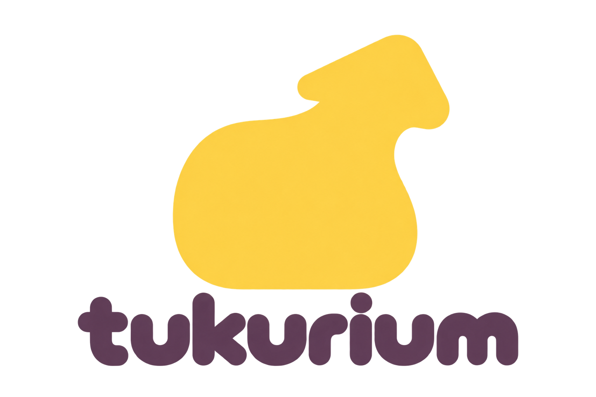

# tukurium



Rust / bevy_ecs のEngineとGodotの表示クライアントを別プロセスで動かす、共同編集の最初のプロトタイプ。各Engine間はGoアダプターを経由してKokoSyncで接続する。Tonariumとのデータ互換性は持たせない。

画面と案内に表示する名前は`tukurium`。既存のワールド、本人情報、テスター向け更新との接続を保つため、実行ファイル名、Rust crate名、`%LOCALAPPDATA%/Kokoverse/`、通信キー、配布版の識別子`Kokoverse-Windows-x64-`、R2バケット名は現時点で維持する。これらは保存・通信・更新に使う内部識別子で、表示名とは別に扱う。

現在は**箱や画像を生成・複製・削除し、名前・位置・回転・スケール・色・Colliderを共有編集できる**。ホストEngineのECS Scheduleが編集を検証・適用し、確定した差分を配信する。Tonariumで使われているお絵描きアバターも表示し、名前・位置・向きを同期する。画面はGodot、ワールドの正本はRustにある。

アバターの移動・ジャンプ・重力も各PCのRust ECSが固定60Hzで計算する。Godotは操作入力を送り、返ってきた姿勢を補間して表示する。表示クライアントを閉じても、Engineは着地まで計算を続ける。

通信と保存は登録済みComponentの共通形式に統一した。値の型検証・編集可否はRustの登録表で定義し、共有パネルの編集占有も汎用のフィールド編集セッションとして扱う。Godotの要求・応答は共通Brokerで対応付ける。現行はprotocol v3・保存format v1で、旧形式のデータ移行は行わない。構成と拡張箇所は [runtime.md](docs/runtime.md) を参照。

## 起動（Windows x64）

配布用のビルド、ZIPと展開済み版の作成、起動確認は [Windows配布版のビルド手順](docs/windows-build.md) を参照。
テスターへの差分配信は [テスター向け差分更新](docs/tester-updates.md) を参照。

### 公開サーバーのセッション・ライブラリ版

開発中のソースを画面で確認する場合は、リポジトリ直下の `Debug.bat` をダブルクリックする。現在のRust・Go・Godotをビルドして、公開サーバーへ `debug` プロファイルで接続する。終了は `StopDebug.bat`。配布済みのテスター版を確認する場合は、ランチャーZIPを展開したフォルダーの `Start.bat` を使う。

```powershell
./scripts/start-online.ps1 -Build
```

HNを入力して「Start」を押すだけで、セッションの作成・参加とアイテムの保存・共有を行える。同じHNなら別のPCでも同じライブラリを使う。接続用パスワードは不要。管理APIは `https://45.77.130.146/api`、同期は既存のKokoSyncを使う。停止は `./scripts/stop-online.ps1`。配布ZIPの `Start.bat` / `Stop.bat` もこの構成を使う。接続設定・サーバー運用は [公開サーバーの構成](docs/deployment.md) を参照。

ワークショップでは保存版を公開し、他のHNのライブラリへ取得できる。保存・編集・共有・再公開のライセンス制限は保留している。操作は [ワークショップ](docs/workshop.md)、今後の方針は [作品の境界と権利の計画](docs/item-boundaries-and-rights.md) を参照。

### ローカルのセッション・ライブラリ版

セットアップ済みの環境では、次でローカル管理サーバーとKokoSync中継を起動し、ユーザー名入力からセッション作成・参加へ進める。

```powershell
./scripts/start-local.ps1 -Build
```

別の利用者は `./scripts/start-local.ps1 -Profile guest`。停止は `./scripts/stop-local.ps1`、共有サーバーも止める場合は全利用者の停止後に `-Services` を付ける。個人ライブラリへの保存・再配置・条件付き共有、本人情報の移行にも対応する。配布ZIPでは `StartLocal.bat` を使う。

接続先、保存先、制限、検証方法は [ローカル管理機能の使い方](docs/local-services.md) を参照。

### 従来の固定ルーム版

PowerShellで、このフォルダーから実行する。

```powershell
./scripts/setup.ps1
./scripts/build.ps1
./scripts/start-demo.ps1
```

初回セットアップはRust、GCC、Go、Godotと動画変換用FFmpegを `.tools/` にダウンロードする。動画ツールだけ追加する場合は `./scripts/setup-media.ps1`。システムのPATHやレジストリは変更しない。Rust 1.99.1、bevy_ecs 0.17.3、Godot 4.7.2、Go 1.27.3を使用し、RustとGoの依存はロックファイルで固定する。

デモはlocalhostのKokoSync中継、ホストとゲストのEngine、それぞれのアダプター、Godotの2画面を起動する。

- `+ Cube`で生成、ワールド一覧または3Dの物体をクリックして選択。
- 選択するとX/Y/Zの移動ギズモが表示される。矢印をドラッグすると移動中の位置も相手に同期される。Shiftで0.25刻み、Escまたは右クリックで取り消し。離すと共有ワールドへ確定する。
- エクスプローラーから画像・GLB/FBXモデル・動画を画面へD&Dして配置。複数ファイルの同時投入と、`Import…`ボタンからの選択にも対応する。移動・回転・拡縮・複製・削除は箱と同じ操作。
- モデル・動画は変換後、転送完了を待たずSlotを共有する。画面上部の転送一覧と仮表示の上に、アップロード待ち・送受信の%と容量・読み込み状況を表示する。読み込み後は同じ物体にモデルを表示し、失敗した取得は`Retry`でやり直せる。
- 動画を選ぶと、インスペクタにPlay/Pause・Restart・再生位置のスライダー・Loopが表示される。操作は全員に同期し、途中参加した画面も現在の位置から再生する。
- `Duplicate`で複製、`Delete…`で確認して削除。インスペクタの値は自動同期する。
- 三人称・フリーカメラは右ドラッグで視点を動かし、右ボタン＋WASDで移動。FPSはマウスで見回し、WASDで移動する。
- FPSではColliderを持つ物体に照準を合わせ、右ボタンを押し続けると保持できる（箱・画像共通）。ホイールで距離、E＋マウスで視点を固定して自由回転、Shift＋E＋マウスまたは横ホイールで垂直軸まわりに回転、Shift＋ホイールで均等拡縮。左クリックで方位を保って傾きを起こし、ダブルクリックで視点への追従を水平回転のみ／上下回転込みで切り替える。右ボタンを離すと配置、Escで取り消す。空間を左クリックするとFPS操作へ戻る。
- Inspectorから名前・色・位置・回転・各軸のスケールとColliderを編集できる。値を変えるとApplyなしで自動同期する（約160ms間隔）。`I`キーまたは上部のInspectorボタンで表示を切り替える。Colliderの有無が選択・把持、Solidがプレイヤーとの衝突を決める。画像の初期設定はColliderあり・Solidなし。保持中も位置・回転・スケールを同期し、離すとまとめて確定する。
- `V`または上部メニューで三人称→一人称（FPS）→フリーカメラを切り替え。フリーカメラではQ/Eで上下移動。
- アバター操作中はSpaceでジャンプ。箱に当たり、箱の上へ乗れる。乗っている箱を動かすと追従する。`F`で選択した物体を見に行く。アバター操作へ戻るには`V`。
- SpaceはUIの決定操作に使わない。メイン画面のボタン・チェックボックスにフォーカスが残っていてもジャンプできる。文字・数値・コードの入力中はジャンプせず、入力欄として扱う。UIのキーボード決定はEnter。
- `PEOPLE`の入力欄で表示名を変更し、Enterで確定。
- `PEOPLE`の`Avatar texture…`でお絵描きアバター用の画像を選び、`Reset`で標準へ戻す。見た目は他の参加者と共有され、次回起動時にも引き継ぐ。
- 物体を選び、Inspectorの`Script Systems…`からLuauの動作を追加する。`Rotator`は回転、`ClickColor`は左クリックで色を切り替える例。コードを書いて`Apply / restart`で反映し、公開パラメータは自動同期する。`Run on host`で停止・再開。コード・設定・明示的な状態も保存・複製できる。詳しくは[UGC Script Systems](docs/ugc-scripting.md)。

```powershell
./scripts/stop-demo.ps1
```

停止スクリプトは、記録した実行ファイル・PID・起動時刻が一致するプロセスだけを停止する。ログは `.run/` にある。Godotを閉じてもEngineは動き続ける。

## 構成

```text
Godot :47000 ↔ Host Engine :47001 ↔ Go adapter
                                      ↕
                             KokoSync :48001 (QUIC)
                                      ↕
Godot :47010 ↔ Guest Engine :47011 ↔ Go adapter
```

- `crates/core`：ECS、実行順を定義したSchedule、ObjectRoot・Slot・Transform・MeshRenderer、編集検証、参加者の状態。
- `crates/protocol`：共有型と、最大1 MiBの長さ付きJSONフレーム。
- `crates/engine`：ホストの編集承認、ゲスト複製、描画クライアント接続、再同期。
- `client-godot`：3D空間、選択、実行時インスペクタ、アバター、参加者一覧。
- `tools/kokosync-adapter`：KokoSyncの配送。ECSの意味や編集ルールは持たない。

詳細は [現在の実装と通信仕様](docs/runtime.md)、設計全体は [design.md](docs/design.md)、KokoSyncの接続方針は [kokosync.md](docs/kokosync.md) を参照。

複数の共有ワールド内インスペクタの背景と実装範囲は [Resoniteのインスペクタ調査](docs/resonite-world-inspectors.md) を参照。

## 検証

```powershell
. ./scripts/env.ps1
cargo test --workspace --locked
cargo clippy --workspace --all-targets -- -D warnings
cargo build --release --workspace --locked
node tests/integration.mjs --godot
node tests/assets-integration.mjs
node tests/assets-integration.mjs --large
node tests/playback-integration.mjs
node tests/playback-integration.mjs --rendered
node tests/avatar-integration.mjs
node tests/persistence-integration.mjs
node tests/ugc-integration.mjs --rendered
node tests/ui-focus-integration.mjs --rendered
node tests/panels-integration.mjs --rendered
```

統合テストは独立したローカル中継・Engine・アダプターを起動して後片付けする。双方向の編集、同一フィールドの競合、重複要求、再接続、不正値、生成・複製・削除、アバターの名前・姿勢同期と退出を確認する。Godotのフォーム・ボタン操作とモデルの読み込みも含む。強制切断では中継側の古い接続が失効するまで再参加を待つため、約1分かかる場合がある。

再生同期テストは3つのEngineとGodotを使い、再生・一時停止・シーク、途中参加、意図的にずらした再生位置の補正を確認する。`--rendered`は描画ウィンドウを開き、シーク後の映像フレームの一致も検証する。

## 現在の範囲

デスクトップ、最大128個の物体（箱・画像・動画・モデル・共有インスペクタ）、画面右側のインスペクタ、アバターと参加者一覧が対象。編集競合はフィールド単位、構造変更はObjectRoot単位のrevisionで拒否する。入力中の別ユーザーの変更でフォームを上書きしない。切断後は未確定の編集を自動再送せず、現在のワールドを取得し直す。

物体を選び、**Ctrl+I** または **Open shared world inspector** で共有パネルを開く。最大16枚で、各パネルの選択欄から別の対象へ切り替えられる。FPSでは通常の物体と同じ右クリック保持・E回転・Shift+ホイール拡縮で配置し、Pinで自分に追従、×で閉じる。パネル内の値は自動同期し、同じ画面のスクロール・入力中の文字・キャレット・編集者も共有する。同じフィールドを別の人や別パネルが編集中なら、その欄は編集不可になる。文字入力中のSpaceは文字として扱い、ジャンプしない。

共有パネルの対象には全員が見えるギズモを表示する。操作する人のハンドルと、他の人への表示を分け、他人の操作で自分の選択を切り替えない。ドラッグのプレビューに合わせて共有ギズモも動く。パネルの配置・対象・サイズ・スクロールはワールドに保存し、入力中のドラフトや6秒で失効する編集占有は保存しない。2つのGodotクライアントで文字・キャレット・編集占有を、3つのEngineで途中参加・保存・復元を検証した。

開発用デモはlocalhostを使う。配布版は `https://45.77.130.146/api` で本人情報・セッション・アイテム保存を管理し、`wss://45.77.130.146/ws` で同期する。セッションごとに異なるルームとホストIDを発行する。公開経路は通常のTLS検証を行う。中継用パスワードは不要。アイテムの所有者と利用権を検証する。ホストの自動交代と異なるPC・ネットワークでの性能評価は未実施。

画像は縦横比を保ち、必要に応じて縮小・圧縮して共有する。1画像192 KiB、ワールド全体の画像データはBase64で512 KiBまで。現在は画像をsnapshotに含めるための上限で、超えた操作は理由を表示して拒否する。

モデルの入力はGLB/FBX、1個100 MiBまで。FBXはバックグラウンドでGLBへ変換して共有する。外部テクスチャはFBXと一緒に配置しておく。GLBはテクスチャ埋め込み形式。最大辺を2mに合わせ、外接直方体のColliderを付ける。モデル内部のメッシュ階層・材質は描画に使い、ワールドでは1個の物体として扱う。

動画の入力はMP4/MOV/WebM/MKV/AVI/OGV、1個100 MiBまで。FFmpegでOgg Theora＋Vorbisへ変換し、最大720p・30fpsの3Dパネルとして音声付きで再生する。動画にも把持用Colliderが付き、右クリックで移動・回転・拡縮できる。再生・一時停止・シーク・リスタート・ループ設定はRustの`MediaPlayback`として共有する。ホスト時刻に合わせて各画面が再生し、途中参加やアセット取得待ちのあとも現在の位置へ追いつく。再生中のずれが0.25秒を超えると補正する方式で、フレーム単位の厳密な同期ではない。

変換後のモデル・動画は1個128 MiBまで。SHA-256をキーに保存し、持っていないクライアントへ128 KiBずつ転送する。配布版の保存先は `.run/online/<profile>/assets/`、従来の固定ルーム版は `.run/assets/shared/`。以前の配布版のポート別キャッシュは起動時にコピーして引き継ぐ。Engine単体の既定は `.run/assets/<UIポート>/` で、`--asset-dir`で指定できる。移動の確定差分には参照だけを含める。ワールドを別環境へ持ち出す場合は、snapshotとホストのアセットフォルダーを一緒に保存する。受信した動画の再生用キャッシュは `.run/media/` に置く。

箱やモデルの上への着地、動く足場、回転・拡縮したColliderとの衝突に対応する。Script Componentは各物体4個・全体32個まで追加でき、LuauのSystemをホストで実行する。現在のquery範囲は取り付け先の物体。親子構造、複数物体のアイテム化、Flux、VR、音声チャット、ホスト移譲は今後の段階。物体の同期はオブジェクト単位の差分、アバターは20Hzの損失許容配送。大規模ワールドは未検証。

アバターの出典と変換方法は [assets/oekaki/README.md](client-godot/assets/oekaki/README.md)。モデル・サンプル画像を移植し、描画処理はGodot用に実装した。Tonariumのアカウントや通信形式は使わない。

## 配布用ZIP

`./scripts/package.ps1`でWindows x64向けZIPを`dist/`に作る。Rustのreleaseビルド、Goアダプター、Godot、お絵描きアバター、起動スクリプト、依存ライセンスをまとめる。受取側で開発ツールは不要。アバターのインポート済みリソースも同梱する。現在のワールドとユーザーが取り込んだアセットキャッシュは含めない。接続用資格情報を配布物へ同梱する必要はない。

展開後は `Start.bat` で起動し、名前を入力してセッションを作成・選択する。接続先は `connection.json` の `service` と `relay` に指定する。中継にはパスワードなしで接続する。動画の変換ツールは `Install-Video-Tools.bat` で導入する。起動ログは `.run/online/<profile>/`、停止は `Stop.bat`。

配布版のホストは約2秒間隔で `.run/online/<profile>/worlds/<session-id>.json` へ変更を保存し、直前の正常な内容を `.bak` に残す。`Stop.bat` は保存と退出の完了を確認して終了する。再開するときは `From saved world…` でワールドを選び、新しいセッションを作る。ゲストはホストの保存ファイルを書き換えない。従来の固定ルーム版は `StartLegacy.bat` / `StopLegacy.bat` を使い、`.run/world.json` と `.run/assets/shared/` に保存する。

Engineを直接起動する場合は `--save <world.json>` で同じ自動保存・復元を有効にできる。`--load <file>` は明示した初期ワールドを読み込む。保存対象は物体・Transform・Collider・画像・動画の再生状態で、参加者の一時的な位置や未確定のドラッグは含まない。モデル・動画の実体はアセットフォルダーに残る。再生中の動画は保存された時刻を基準に進むため、再起動までの時間も経過する。保存UIとホスト交代は未実装。

同じPCで複数フォルダーから起動するときも、ローカルのIPCポートはOSの空きポートから自動選択する。ポート確保とEngine起動の間は起動用Mutexで直列化する。フォルダーのコピーを検出すると参加者IDを作り直す。起動中のポート・参加者IDは各フォルダーの`.run/connection.json`に記録する。配布版を用いた並行起動の確認は`./tests/launcher-smoke.ps1 -PackageRoot <展開フォルダー>`で実行できる。
