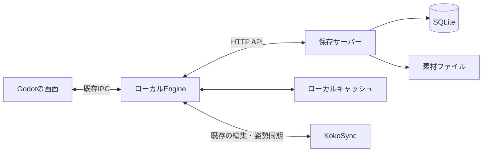

# ユーザー名だけで使い始める、アセット保存サーバーの実装計画

作成日：2026-10-23 / 状態：当初の実装計画。ローカル初版は実装済み。公開サーバーへ配置済み。

2026-10-24更新：ライセンス機構の開発は保留する。今後の順序は[作品の境界と権利の計画](item-boundaries-and-rights.md)を優先し、以下の「共有と権限は最初から入れる」は当初案として読む。ワールド内の共同操作を所有者・ライセンスで制限する処理は解除した。ライブラリの保存・取得・共有・再公開も所有者やライセンスで拒否しない。作者情報と保存データは維持している。

現行仕様：HNだけで開始し、同じHNなら同じ利用者・ライブラリを使う。接続用パスワードと本人情報ファイルの移行は不要。以下の当初案にある「同名でも別ユーザー」等は置き換え済み。詳しくは [公開サーバーの構成](deployment.md) を参照。

実装追記：ローカル管理サーバー、ユーザー名入力、セッション管理、単一アイテムの保存・共有を追加した。現在の起動方法・実装範囲・APIは [ローカル管理機能](local-services.md) を参照。本書の以下の内容は当初の計画として残す。

最初の目標は、**ユーザー名を入力して作品を保存し、再起動や別PCでも取り出せること。その作品を、許可した相手にだけ渡せること**とする。メールアドレス登録やパスワード入力は設けない。

保存するのは素材だけでなく、構造・設定・ロジックを持つアイテムである。ワールドに置いたアイテムを他人が使えても、その人のライブラリへ保存できるとは限らない。ユーザー名入力から保存・取得・権限確認までを一つの流れとして実装する。

本書は [アイテム・ライブラリ・ワークショップの設計書](item-library-workshop-design.md) を実装順に具体化したもの。今回のユーザー名入力方式は、本書を優先する。記載するエンドポイント名や内部テーブル名は初期案だが、利用者に提供する動作と完了条件は実装の基準にする。

開始画面とセッションの作成・参加は [セッション管理の実装計画](session-management-plan.md) に記載する。管理APIとユーザー識別を共通で使い、参加後の同期には既存のKokoSyncを使う。

## 1. 初版で完成させる範囲

| 機能 | 初版の到達点 |
|---|---|
| 利用開始 | ユーザー名を入力する。次回は保存済みの本人情報を使う |
| セッション | 作成者のPCをホストとして開始するか、一覧から参加先を選ぶ。詳細は別計画を参照 |
| 素材保管 | モデル・画像・動画・サムネイルをアップロードし、必要なときに取得する |
| アイテム保存 | まず単一オブジェクトの見た目・設定・ロジックを一つの保存版にする |
| ライブラリ | 一覧表示、名前変更、サムネイル表示、再配置、一覧からの削除 |
| 履歴 | 保存者と保存時刻、編集者と時刻を表示する |
| 共有 | 相手のユーザーIDを指定して、保存版の取得権を渡す |
| 利用条件 | 自分用の複製、改変、再配布を区別し、保存・取得時に判定する |
| 別PCへの移行 | 試験用の本人情報エクスポート・インポートで同じライブラリを使う |

ワークショップと無料アセットストアは後続工程で作る。初版でも、同じ保存版を公開できるデータ構造にする。有料決済、複製不可の一点物、複雑なグループ所有、複数部品の親子構造は今回の完了条件に含めない。

## 2. 画面はユーザー名だけ、内部では本人情報を持つ

ユーザー名は表示名として扱う。同じ名前を使う人がいてもよい。名前を入力し直しただけでは、別の人のライブラリを開けない。

初回はアプリが暗号学的な乱数で32バイトの認証キーを生成し、通信する前に端末へ保存する。管理APIはそのキーを登録してランダムな `user_id` を発行し、以後はキーから操作主体を決める。利用者がキーを入力する場面はない。API側にはキーのハッシュだけを保存する。

```text
初回：ユーザー名入力 → 認証キーを自動生成・登録 → ID発行 → 開始画面
次回：保存済みの本人情報を読み込む → 開始画面
開始画面：セッション作成・参加、または自分のライブラリを開く
```

本人情報には、接続先サーバー、ユーザーID、認証キーを含める。サーバーが違う場合に取り違えない。保存場所はワールドやアセットのキャッシュと分け、製品ZIP、ワールド保存、ログ、Gitへ混ぜない。Windowsではユーザー別のアプリデータ領域を使い、認証キーをOSの保護機能で保管する。テスト用には独立したプロファイルの保存先を指定できるようにする。

現在の起動処理にあるユーザー名入力を利用し、別のログイン画面を増やさない。表示名を変更しても、ユーザーIDとライブラリは維持する。サーバーが応答しないときに、新しい本人情報を黙って作り直してはいけない。

別PCでは、利用者が明示的に書き出した本人情報を取り込む試験用の移行機能を用意する。このファイルは認証情報そのものであり、自動共有しない。通常の配布ZIPにも含めない。失った場合にユーザー名だけで復旧する機能は初版に設けず、公開運用前に復旧・端末追加方式を見直す。

共有相手は、表示名と一緒に示すユーザーコードで指定する。同名の別人に権利を渡す事故を避けるため、確定前に表示名とコードを両方見せる。

## 3. 最初は一つのサーバープロセスで動かす

初版は、Rustの管理API、SQLiteの管理DB、サーバーのローカルディスク上の素材保管先を組み合わせる。既存Engineとは別の実行ファイルにし、ワールドや描画クライアントが終了しても保存データは残る構成にする。



HTTP通信と認証キーの利用はローカルEngine側へ寄せる。Godotには一覧、進捗、操作結果を返す。画像や動画の変換は既存の取り込み処理を使い、サーバー側で新たな変換基盤を作らない。

管理APIはRustのHTTPフレームワークを使い、第一候補はaxumとする。SQLiteはAPIプロセスを通して使い、複数PCからDBファイルを直接共有しない。SQLiteは同時書き込みが一つに限られるため、小規模な単一サーバーを前提に採用する。[SQLiteの利用指針](https://www.sqlite.org/whentouse.html)

ローカル試験はループバックのHTTPで動かせるようにする。外部から使う場合はHTTPSの入口を設ける。実際に配置するホスト、ドメイン、ディスク容量は未決であり、この計画書をもって公開環境へ配置することはしない。

素材の読み書きは保管方式を交換できる境界にまとめる。初版はディスクで動かし、容量や配信量が増えたらオブジェクトストレージへ移せるようにする。最初から別の配信サービスを必須にしない。

## 4. サーバーが管理するデータ

| データ | 主な内容 |
|---|---|
| users | ユーザーID、表示名、作成日時 |
| credentials | ユーザーID、認証キーのハッシュ、失効状態 |
| assets | ハッシュ、形式、サイズ、保管先、検証結果 |
| uploads | アップロードID、実行者、想定ハッシュ・サイズ、有効期限、完了状態 |
| asset_access | 素材をアップロードした利用者や、アクセスを許可する保存版との関係 |
| items | 作品ID、作者、名前、最新の保存版ID |
| item_versions | 保存版ID、元の版、内容、内容のハッシュ、保存者、サーバー時刻 |
| version_assets | 保存版が必要とする素材の一覧 |
| version_editors | 保存版に含まれる編集者IDと編集時刻 |
| library_entries | 利用者、保存版、表示名、追加日時 |
| grants | 誰に、どの版を、どの利用条件で渡したか |

保存版は変更不可とし、編集後の保存では新しい版を作る。一覧から消す操作と、素材の物理削除は分ける。他の人が取得した版や既存ワールドから使う素材を、一人の一覧削除で消さない。

作者や利用権はクライアントが自由に書き換えられるメタデータにしない。APIが操作主体と既存の権利から決める。編集者と時刻の記録は簡潔に保ち、サーバーが直接確認した記録と、ワールドホストから届いた記録を内部で区別する。

## 5. アイテムを保存する流れ

1. 利用者が選択中のオブジェクトに対して「ライブラリへ保存」を押す。
2. ワールドのホストが、確定済みの状態と保存に必要な権限を確認する。
3. 構造・設定・ロジック・必要素材・元の版をまとめる。通常の画像も埋め込み状態から素材として収集する。
4. ローカルEngineが不足する素材をアップロードする。
5. 管理APIが、素材の存在とアクセス権、保存元の利用条件、内容の形式を検査する。
6. 保存版とライブラリ登録を同じDBトランザクションで確定する。
7. Godotへ成功を返し、ライブラリに新しい版を表示する。

操作開始時の確定状態を使い、転送中に進んだ編集と混ぜない。途中で失敗した場合、前の保存版は残す。再試行で作品や版が重複しないよう、保存要求には一意なリクエストIDを付ける。

素材は一時ファイルへストリーミングし、ハッシュ・形式・サイズを確認してから正式な保存先へ移す。全素材が検証済みになるまで保存版を公開しない。同じハッシュのファイルは保管を共通化できるが、ハッシュを知るだけで取得権や再配布権が発生することはない。

素材の初期上限は既存の変換後上限に合わせ、1ファイル128 MiBとする。ユーザー別の保管量、全体の空き容量、同時転送数にも設定可能な制限を持たせる。APIの本文制限はエンドポイントごとに設定する。初版はファイル単位で再送できればよく、同じファイルの途中位置からの再開は後続改善とする。

素材だけ残った未完了アップロードは、保存版から参照されていないことを確認して後片付けする。完成済みの素材や取得済み作品を時間だけで削除しない。

## 6. 共有と権限は最初から入れる

初版の取得は、自分用の複製を許可する方式に統一する。配布時に「改変可」「再配布可」を選ぶ。所有者が自分の作品を保存する場合にも、含まれる第三者の素材や元の版に付く条件は確認する。

| 操作 | 判定すること |
|---|---|
| 表示用素材の取得 | そのワールドで表示を許された対象か、または取得済みの作品か |
| ライブラリへ追加 | 作者からの取得許可、または既存の有効な利用権があるか |
| 編集した版の保存 | 元の版の改変が許されているか |
| 相手へ共有 | 再配布が許され、次の相手へ渡す条件が元の条件を超えていないか |
| 公開・ストア掲載 | 作品本体と必要素材をその条件で配布できるか |

初版の共有画面は、相手のユーザーコードと二つのチェック項目だけにする。共有成功時は利用権と相手のライブラリ登録をまとめて作る。同じ共有の再送では二重登録しない。

ワールドに置かれた作品については「利用」「移動」「編集」「取得」を分ける。表示・利用を許したセッションには、その作品を表示するための期限付き許可を発行する。これはライブラリへの取得権に変換しない。子要素や依存素材にも判定を通し、箱へ入れてまとめる操作で制限を外せないようにする。

セッションの参加者IDと保存サーバーのユーザーIDを結び付けるには、APIが発行する短期の参加証明を使う。ホストは証明の有効性、接続先セッション、接続中の参加者との対応を確認する。本人用の認証キーを他の参加者やワールドホストへ渡さない。

ただし、初版のワールドホストは参加者のPC上で動く。管理APIで取得・再配布の権利を確認しても、改造されたホストやクライアントによる素材の抜き出しや作者情報の偽装を完全には防げない。検証対象は、正規の保存経路・API・スクリプトで制限を迂回できないこととする。

スイッチを押して点灯させるような通常動作は、コードの改変とは分ける。改変不可の作品でも、作者が許した操作は使える。

## 7. APIの初期構成

以下は実装開始時にOpenAPIへ起こす契約のたたき台。今回はHTTPサーバーや外部ワークスペースを作成しない。

| API案 | 認証 | 入出力と役割 |
|---|---|---|
| `GET /health` | 不要 | 起動状態を確認。DB内の情報は返さない |
| `POST /v1/guest-users` | 新規キーを受理 | 表示名と端末で生成したキーを登録し、IDを返す |
| `GET /v1/me` | 必要 | 自分のIDと表示名を取得する |
| `PATCH /v1/me` | 必要 | 表示名を変更。ユーザーIDは維持する |
| `POST /v1/uploads` | 必要 | ハッシュ・形式・サイズから転送要求を作る |
| `PUT /v1/uploads/{id}/content` | 必要 | 自分のアップロード要求へ素材を送り、検証する |
| `POST /v1/items` | 必要 | 最初の版を保存し、自分のライブラリへ登録する |
| `POST /v1/items/{id}/versions` | 必要 | 元の版と期待する最新の版を指定して保存する |
| `GET /v1/library` | 必要 | 自分の保存・取得済み作品をページ単位で取得する |
| `PATCH /v1/library/{entry}` | 必要 | 自分の一覧内の表示名を変える |
| `DELETE /v1/library/{entry}` | 必要 | 自分の一覧から外す。利用権や素材の一括削除はしない |
| `GET /v1/versions/{id}` | 必要 | 利用権に応じて定義または表示用情報を取得する |
| `POST /v1/versions/{id}/grants` | 必要 | 相手と利用条件を指定し、取得権と一覧登録を作る |
| `GET /v1/assets/{hash}` | 必要 | 対象素材への権限を確認して配信する |
| `POST /v1/sessions/{id}/join` | 必要 | セッションの状態を確認し、接続情報と短期の参加証明を発行する |

表示用の取得は別の短期許可を用い、作品全体の取得・保存用データを無条件に返さない。セッションの登録・一覧・参加・稼働報告・終了は [セッション管理の実装計画](session-management-plan.md) にまとめる。参加証明の検証と表示許可の発行手順は、セッション連携工程で契約に追加する。ロジックのソースを秘匿する保証は初版には含めない。

認証キーは `Authorization: Bearer ...` で送る。利用者登録では未登録のキーを受け入れ、既存のキーでの再送には同じIDを返す。既存ユーザーの名前変更には専用の更新APIを使う。

新規作成・保存・共有では `Idempotency-Key` を受け付ける。同じユーザーとキーの再送には同じ結果を返し、内容が異なる再利用は競合として扱う。最新の版が変わった場合も、他人の更新を上書きせず競合を返す。

認証失敗、権限不足、存在しない対象、競合、容量超過、不正な素材を区別したエラーを返す。非公開対象の存在を明かさない経路では、権限のない対象も未検出として返す。レスポンスにはエラーコードと表示用メッセージを持たせ、Godotで理由を示せるようにする。

一覧は追加日時とIDを基準とするカーソル方式にし、件数の上限を設ける。初版の検索はライブラリ内の名前検索までとする。

## 8. 実装する場所と順番

新設する `crates/asset-server` に管理API、認証、DB、素材保管をまとめる。共有する保存形式とエラー型は、既存プロトコルとの境界を確認して定義する。HTTP固有の型をECSへ持ち込まない。

ローカルEngineには通信処理、転送キュー、保存要求の進捗、ライブラリからの配置を追加する。Godotにはライブラリの画面と保存・共有操作を追加する。既存のスクリプト実行器を作り直すことは、この工程に含めない。

| 工程 | 作業 | 完了条件 |
|---|---|---|
| 1. 形式と契約 | 保存形式、版、権限、本人情報、OpenAPIを定義 | 単一オブジェクトの往復と、許可・拒否の例を記述できる |
| 2. 保存サーバー | 起動設定、DB初期化、ゲスト利用開始、素材転送、版の保存 | APIだけで保存・取得でき、サーバー再起動後も残る |
| 3. 本人・権限連携 | プロファイル、参加証明、所有者、保存・改変・共有の判定 | 同名の別人や、名前・IDの自己申告では他人の作品を取れない |
| 4. ライブラリ画面 | 保存、一覧、進捗、配置、名前変更、一覧からの削除 | ユーザー名入力後、画面操作だけで保存して再配置できる |
| 5. 別PCと共有 | 本人情報の移行、相手への権利付与、再送・切断対応 | 別PCで同じ棚を開け、許可した相手だけ取得できる |
| 6. 配布準備 | 起動・停止・バックアップ手順、容量設定、統合検証 | 別の環境でも再現できる手順を文書化する |

各工程で形式やAPIを必要以上に先回りして増やさず、次の工程が使う範囲まで動作を確認する。工数と日程は、工程1で既存の保存・インポート処理との接続箇所を確定してから見積もる。

## 9. 運用と失敗時の動作も初版に含める

サーバーはデータディレクトリ、待ち受け先、転送上限、容量上限を設定で受け取る。DBと素材の保管先を、実行ファイルや配布ZIPから独立させる。マイグレーション番号を持ち、起動時に対応できないDBを黙って初期化しない。

バックアップはDBと、そのDBが参照する素材をそろえて取得する。初版はサーバーを停止した状態でのバックアップ・復元手順を用意し、復元後に保存版と素材の整合性を検査する。利用中バックアップは後続改善とする。

通信失敗時は「再試行待ち」「保存に失敗」「保存済み」を区別する。APIから成功を確認するまで、画面上でクラウド保存済みとは表示しない。ローカルで編集した状態は保ち、サーバーの失敗でワールドのオブジェクトを消さない。

初回登録の応答が失われても、端末には認証キーが残っている。同じキーで再試行して、登録済みなら同じユーザーIDを返す。認証キーを含む応答をサーバーへ保存し直す必要はない。端末の本人情報そのものを失った場合は、名前だけでは復旧しない。

ログにはリクエストID、処理時間、操作結果を記録する。本人用キー、短期許可、移行用の本人情報は記録しない。ゲスト作成や転送には頻度制限と容量制限を設ける。外部公開時の設定値は、試験の同時利用人数と保存量を見て決める。

## 10. 最終確認シナリオ

| シナリオ | 合格条件 |
|---|---|
| ユーザー名だけで開始し、アプリを再起動 | 同じユーザーIDとライブラリへ戻る |
| 同じ名前で別のプロファイルを作る | 別ユーザーとして扱い、元の人の棚へ入れない |
| ロジック付きのモデルを保存して元を消す | 再起動後に形・設定・ロジックを復元できる |
| 同じ作品を二つ配置する | 個体IDと実行状態が分かれる |
| 保存中に通信を切り、再試行する | 不完全な版や重複登録を作らない |
| 本人情報を別PCへ明示的に移行する | 同じ棚を使え、キャッシュが空でも素材を取得できる |
| 置かれた作品を他人が利用してから保存する | 利用できても取得権がなければ保存を拒否する |
| 改変可・再配布不可で相手へ共有する | 相手の編集保存は成功し、別の人への共有は拒否する |
| 同じ要求をUIを通さずAPIへ送る | 同じ本人・利用権で判定する |
| 制限された素材を箱や派生版へ含める | 組み合わせても保存・配布の制限が外れない |
| ワールドを保存して復元する | 所有者と利用条件を保持し、参加者の取得権を増やさない |
| DBと素材をバックアップから復元する | 同じユーザー・利用権・保存版で使える |

性能や上限値はこの検証で計測し、実測結果を残す。別PCでの確認と同じPCの複数プロファイル試験は区別して報告する。

## 11. 後続工程へつなげる

初版が通ったら、同じ保存版と利用権に対して公開情報を追加し、ワークショップと無料ストアを作る。名前・説明・サムネイル・公開範囲・配布条件を管理し、取得時には既存の権限判定を使う。

複数部品のアイテムと外部への動的参照は、保存する内容を広げる別工程にする。アセット保管やライブラリのAPIを作り直さず拡張できるか、保存形式のバージョンで検証する。

本人確認の強化、端末追加、認証キーの失効・復旧、有料販売、オブジェクトストレージへの移行は、その後の運用条件に応じて追加する。初版で本人用キーを裏側に持つ構成にしておけば、ユーザー名だけの入口を保ちつつ、正式なアカウントへ結び付ける余地を残せる。
