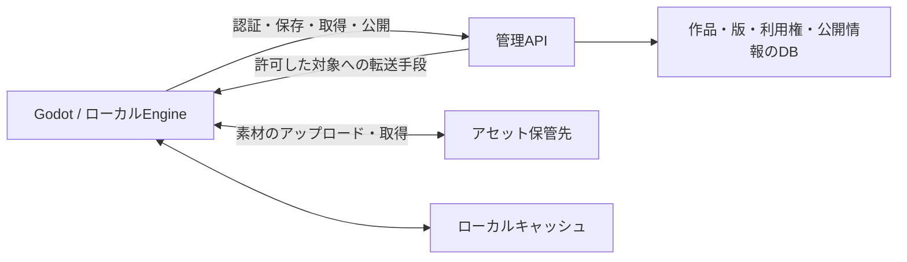

# アイテムを単位に、保存・共有・ストア公開をつなぐ

作成日：2026-10-23 / 状態：設計案。実装済みの機能を説明する文書ではない。

2026-10-24更新：ライセンス機構の開発は保留し、複数部品を作品としてまとめる境界と保存・複製を先に検討する。[最新の概念と計画](item-boundaries-and-rights.md)を優先する。ワールド内の共同操作を所有者・ライセンスで制限する処理は解除した。以下の利用条件・権限の詳細は将来案として残す。

初版の実装状況は [ローカル管理機能](local-services.md) に記載する。本書は、複数部品のアイテムやワークショップなど、後続工程を含む全体設計である。

Kokoverseでは、**アイテムの内部に構造とロジックを持たせ、外部との関係は配置先で解決する**。同じアイテムを自分のライブラリへ保存し、ワークショップで共有し、アセットストアへ公開できるようにする。

ワールドに置いたことだけでは、他人に保存・複製・再配布の権利を与えない。利用者と時刻を記録した簡単な編集履歴を残し、アイテムの利用条件を各操作で確認する。

本書は、この方針から最初のプロトタイプの範囲と、今後決める事項を整理したもの。細かなAPI名やデータ形式は実装時に確定する。

具体的な実装順とサーバー構成は [アセット保存サーバーの実装計画](asset-library-implementation-plan.md) を参照する。利用開始はユーザー名入力だけとし、内部では自動生成した本人用キーとユーザーIDを使う。メールアドレスやパスワードの入力は初版に設けない。

## 1. ここまでに合意した方針

| 項目 | 方針 |
|---|---|
| ロジックの単位 | アイテム単位で記述する |
| 外部との関係 | 親、保持している人、ワールドなどは動的に参照する |
| 保存するもの | 見た目の素材に加え、構造・設定・ロジックを含める |
| 編集履歴 | ユーザーと時刻が分かる程度。詳細な操作ログや変更説明は必須にしない |
| 保存・公開 | 個人ライブラリ、ワークショップ、アセットストアを扱う |
| 権限 | 配置・閲覧と、保存・複製・再配布を分ける |
| 最初の取り組み | 作品の境界と保存・複製を整える。ライセンス機構の開発は保留する |

以下の初期設定、実装順、権限の継承方法は提案であり、すべてが決定済みという意味ではない。

## 2. まず作りたいのは「別の場所でも使える作品」

例として、スイッチを押すと光るランタンを考える。外装、光源、スイッチ、点灯ロジックを一つのアイテムにまとめる。内部ではスイッチが自分の光源を参照する。持ち主や配置先のワールドは、実行時に取得する。

作者がランタンをライブラリに保存すれば、元のワールドから消しても取り出せる。別の人が置かれたランタンのスイッチを押せても、それだけでは自分の棚へ保存できない。作者が取得を許可したときに、指定された利用条件でその人のライブラリへ追加される。

その後、作者は同じ作品の保存版をワークショップやストアへ公開する。公開後も手元では制作を続けられ、更新版を出すまでは配布中の内容は変わらない。

## 3. アイテムの定義、保存版、配置中の個体を分ける

| 要素 | 持つ情報 | 変更の扱い |
|---|---|---|
| アイテム | 継続して同じ作品を識別するID、名前、作者 | 制作を続けても作品のIDは保つ |
| 保存版 | 版のID、内容のハッシュ、構造、設定、ロジック、素材参照、編集履歴 | 保存ごとに版を作る。確定した版は書き換えない |
| 配置中の個体 | 新しい個体ID、位置、実行状態、外部との接続 | 配置先で動作・編集する |
| ライブラリ登録 | 利用者、取得した保存版、利用権、整理用の情報 | 自分の棚で管理する |
| 公開情報 | 公開する保存版、説明、画像、公開範囲、配布条件 | ワークショップやストアに表示する |

保存版のIDと、ワールド上の個体IDは別にする。複製や再配置で新しい個体IDを割り当て、内部の参照関係を維持する。実行中のECS Entity番号やGodotのNodePathを保存用IDにはしない。

取得した作品を編集して保存した場合は、元の保存版を上書きせず派生版として残す。コピー元の作品と版を記録し、元の作者の情報や利用条件を失わないようにする。派生作品を新しい作品として扱う条件は、後述の未決事項に含める。

## 4. 内部参照は保存し、外部参照は配置先で結び直す

アイテム内部の部品には安定したローカルIDを割り当てる。ランタンを複製しても、複製後のスイッチは複製後の光源につながる。

| 参照の種類 | 保存する内容 | 実行時の扱い |
|---|---|---|
| 内部の部品 | アイテム内のローカルID | 同じ個体の中で解決する |
| 親・保持者・現在のワールド | 何を取得したいかという指定 | 現在の配置・保持関係から取得する |
| 外部の特定機能 | 「電源入力」「操作対象」などの接続口の定義 | 配置先で明示的に接続する |

通常のアイテム保存には、元のワールドにしか存在しない外部オブジェクトのIDを固定で埋め込まない。ワールド保存では、そのワールド内の接続関係を別途保存してよい。

親が変わったり、保持者が交代したりしたら、古い接続を失効させて再取得する。接続先が見つからない場合は未接続として扱い、依存する処理を止める。無関係な対象へ自動でつなぎ替えない。

参照を取得しても、相手を自由に変更できるわけではない。外部への書き込みは接続口が許す操作に限定し、実行時にも対象の生存と権限を確認する。ロジックにワールド全体の無制限な操作権限を渡さない。

## 5. 保存には設定を含め、実行中の状態は選んで残す

アイテム保存には、部品構成、ローカルな位置関係、設定値、ロジックのソース、公開パラメータ、素材への参照、外部接続口の定義を含める。配置時の基準になる原点を持ち、元のワールドの絶対座標は標準の配置位置にしない。

ランタンの明るさや色は保存する。一方、直前に操作した人、保持中の相手、実行中のタイマー、VMやコンパイル済みプログラムは、通常のアイテム保存には含めない。点灯状態のように残したい値は、保存対象と明示された設定として扱う案とする。

| 保存の目的 | 復元する内容 |
|---|---|
| アイテム保存 | 別の場所で使い始められる構造・設定・ロジック |
| ワールド保存 | 配置位置、ワールド内の接続、継続に必要な実行状態 |

現行のスクリプトには明示的な `state` がある。ワールドの継続保存で使う状態と、アイテムを書き出す際の設定を区別する必要があり、既存の保存動作を一律に変更しない。

保存は、ホストが確定した一つの状態を対象にする。保存中に編集が進んでも、構造は新しいが素材参照は古い、といった混在を起こさない。必要な素材がすべて保管されたあとに保存版を確定する。失敗時は直前の保存版を残し、未完成の版を一覧に出さない。

## 6. 編集履歴は「誰が、いつ」に絞る

最初の保存メタデータは、次の程度に抑える。

| 情報 | 用途 |
|---|---|
| 作成者・作成日時 | 作品の起点を表示する |
| 保存者・保存日時 | この保存版を作った人と時刻を表示する |
| 編集者・編集日時の一覧 | 制作に関わった人を表示する |
| 元の保存版ID | 前の版や派生元へたどる |

編集者の一覧は、保存版ごとに、その区間で編集したユーザーと各ユーザーの最終編集時刻を残す初期案とする。ドラッグ中の全座標、詳細な差分、必須の変更メモは持たない。スクリプトの毎フレームの動作は、人の編集履歴として記録しない。

ユーザーは表示名で識別せず、継続して使えるユーザーIDで記録する。接続中の参加者IDだけでは作者の証明にならない。クラウド上の履歴は、認証された操作から記録し、クライアントが申告した作者や時刻をそのまま信用しない。ローカルだけで作った記録は、確認済みのクラウド履歴と区別する。

編集履歴は貢献の記録であり、所有権や再配布権を付与するものではない。

## 7. ワールドでの操作権限と、取得後の利用権を分ける

本書でいうライセンスシステムは、まずアプリ内で強制する権限の仕組みを指す。改変・再配布などの利用条件を保存し、各操作で判定する。法的な利用規約の文面は別途決める。

### 置かれたアイテムに対する権限

| 権限 | 許可する操作 | ランタンの初期設定案 |
|---|---|---|
| 利用 | 公開されたスイッチなどを操作する | 参加者に許可 |
| 移動 | 持つ、運ぶ、位置や向きを変える | 所有者と指定した人 |
| 編集 | 構造、設定、ロジックを変更する | 所有者と指定した共同編集者 |
| 取得 | 自分のライブラリへ追加する | 所有者以外は不可 |

「利用」は、作者が公開した操作の範囲を意味する。ボタンを押して光らせる権限から、ロジックの書き換え権限は得られない。サイズ変更は初期案では編集に含める。

点灯・消灯のように、作品内の許可されたロジックが実行状態を変えることは、利用者による構造・コードの改変とは区別する。改変不可のランタンでもスイッチは使える。スクリプトにはその個体で許された動作の範囲だけを与え、操作した人の権限で別の作品を書き換えることは許さない。

### 取得した人に渡す利用権

| 利用権 | 許可する操作 |
|---|---|
| 自分用の複製 | 自分のライブラリから複数の個体を配置する |
| 改変 | 許された範囲を編集し、自分用の派生版を保存する |
| 再配布 | 別の利用者へコピーを渡す、公開する、ストアへ出す |

最初のプロトタイプは、自分用の複製を許す取得方式を扱う。改変・再配布は配布時に選ぶ。複製できない一点物の移動・譲渡は、個数や所有権の移転を管理する必要があるため、後の段階に分ける。

取得は所有者の許可、共有リンク、ワークショップ、ストアなどを通して行い、その保存版に対する利用権を記録する。見えていることや、素材がPCにキャッシュされていることだけでは、取得済みとは扱わない。

### 制限を迂回させないための判定

作者、現在の所有者、利用権を持つユーザーは別の情報として保持する。購入・取得しても元の作者は変わらず、共同編集者が勝手に配布条件を緩めることもできない。

取得、保存、複製、改変、再配布の判定は、それぞれ対応する操作で行う。所有者でも、取り込んだ第三者の素材やアイテムに付く制限は超えられない。

初期案では、必要な構成物の権限をすべて検査する。保存できないアイテムを箱へ入れて箱ごと保存したり、再配布できない素材を家具セットへまとめて公開したりする操作は拒否する。黙って一部を削って保存せず、制限のある構成物を表示する。部品ごとの複雑な編集許可は後の拡張に回す。

ワールドの保存・復元は、そのワールドの継続に必要な配置を保持する操作とする。保存した人や参加者の個人ライブラリへ、全アイテムの取得権を付けない。復元時にも所有者と利用権の関係を保ち、必要な権限を確認できない場合は対象を利用不可として示す。

## 8. ライブラリ、ワークショップ、ストアは同じ保存版を使う

| 場所 | 目的 | 主な操作 |
|---|---|---|
| マイライブラリ | 自作・取得済み作品を保存して使う | 保存、整理、検索、配置 |
| ワークショップ | 作品を共有し、試し、制作を続ける | 公開、閲覧、取得、許可された派生 |
| アセットストア | 配布物を探し、条件を確認して取得する | 商品情報の閲覧、パッケージ取得、更新確認 |

導線は「制作 → 自分の棚に保存 → 必要に応じてワークショップやストアへ公開」とする。公開先ごとに作品本体を作り直す必要はない。ワークショップとストアは公開情報として同じ保存版を参照できる。

ストアでは、単品に加えて家具セットなどの複数アイテムを含むパッケージを扱える構成にする。最初は無料配布を対象とし、決済、売上分配、有料販売の運用は範囲外とする。

公開範囲は非公開・限定公開・公開を候補とする。限定公開のリンクは、閲覧できるだけのリンクと、取得権を付与するリンクを混同しない。公開範囲と配布条件は別に設定する。

更新は新しい保存版の公開として扱う。初期案では既存の配置を自動更新しない。取得者が内容を確認して更新し、必要なら以前の版を使い続けられるようにする。公開停止は新規取得を止め、すでに渡した利用権は原則として維持する案とする。削除要請などの例外は別途検討する。

## 9. アセットサーバーは保管・配信を担当する

管理APIは認証、作品の登録、保存版の確定、利用権、公開情報を扱う。大きな素材はアセット保管先へ置き、ローカルキャッシュで再利用する。位置や編集操作の同期を扱うKokoSyncとは、責務を分ける。

現在のSHA-256による素材識別を生かす。ただし、同じハッシュを知っていることはアクセス許可を意味しない。非公開の素材は、その作品を表示・取得する権限を確認してから配信する。

現在、通常の画像はワールド状態へ直接埋め込まれている。アイテムを書き出す際は画像も素材として収集できるようにし、モデル・動画と同様に保存版から参照する形式へ段階的にそろえる。

S3型の保管先を使う場合、管理APIが期限付きURLを発行して、クライアントが素材を直接送受信する構成が候補になる。こうしたアップロード・ダウンロードは[公式の署名付きURLの仕組み](https://docs.aws.amazon.com/AmazonS3/latest/userguide/using-presigned-url.html)で実現できる。採用サービス、DB、配置先はまだ選ばない。

素材はハッシュだけでなく形式とサイズも検査する。保存版が参照する素材一式を確認してから登録を確定する。同一のリクエストが再送されても、利用権や公開情報を二重登録しないようにする。

キャッシュは再取得できる一時データとして扱い、作品の保存先には数えない。素材の削除は、ライブラリ、保存版、公開物、ワールドからの参照が残っていないか確認して行う。試作初期は自動削除を急がず、明示的に管理する。

## 10. 権限はUIだけでなく、実行側で確認する

UIは実行できない操作を説明付きで無効にする。最終的な拒否は、ワールド操作なら権威を持つEngine、ライブラリや公開物なら管理APIが担当する。スクリプト経由の操作にも同じ判定を通す。

現在は各参加者のPCでEngineが動く。利用者が改変できるローカルEngineだけに、クラウドの利用権の正本を任せない。管理APIは自ら利用権を確認し、将来、複数ユーザー間で強い強制力が必要になれば、信頼できる専用ホスト側での検証も検討する。

表示や実行のためにデータを相手のPCへ送る以上、改造クライアントによる抽出まで完全に防ぐ保証はしない。プロトタイプで検証するのは、正規のクライアント・API・スクリプト操作で制限を迂回できないこと。ロジックの秘密保持や素材の完全なコピー防止は、別の要求として扱う。

参考にしたSecond Lifeは、ワールド上で他人がコピーできる設定と、次の所有者に許す変更・複製・譲渡を分けている。本設計もその区別を参考にするが、同じ仕様の再現は目的にしない。[Second Life公式の権限説明](https://wiki.secondlife.com/wiki/Viewerhelp%3APermissions)

## 11. 現在の実装から段階的に広げる

2026-10-23に確認した範囲では、ワールドの自動保存、モデル・動画などのハッシュによる保管・転送がある。また、別の作業でLuauのScript Componentとホスト側実行を開発中である。本書作成時にその動作検証はしていない。

現在のスクリプト設計は、取り付け先の単一オブジェクトを操作する段階にある。親子構造、複数オブジェクトをまとめたアイテム、クラウドライブラリは今後の拡張になる。既存の実装状況は [runtime.md](runtime.md) と [ugc-scripting.md](ugc-scripting.md) を参照する。

| 段階 | 作るもの | その段階で確認する体験 |
|---|---|---|
| A | 単一オブジェクトのアイテム保存、メタデータ、ローカルライブラリ | ロジック付きの作品を保存し、再起動後に取り出せる |
| B | 継続したユーザーID、所有者、取得・改変・再配布の権限判定 | 他人の配置物を使えても、無断で棚へ保存できない |
| C | クラウドの保存版・利用権管理、アセット保管・配信 | 別のPCでも取得済み作品を使える |
| D | 複数部品のアイテム、内部参照、外部の接続口 | 持ち替えや別ワールドへの配置でも参照が混ざらない |
| E | ワークショップ、無料ストア、パッケージ、版の公開 | 同じ作品を公開し、条件付きで他人に配布できる |

段階Aのローカル保存では、クラウドで証明された所有権を保証したとは扱わない。Aで形式と体験を確かめ、B・Cで複数ユーザー間の制御を成立させる。ストアを公開する前に権限判定を完成させる順序とする。

初期の画面は、アイテムの「保存」「詳細」「共有設定」と、ライブラリの一覧・配置を中心にする。詳細には作者、保存日時、編集者、元の版、許可された操作を表示する。「保存できません」だけで終わらせず、所有者から取得許可が必要なのか、構成物に制限があるのかを示す。

## 12. プロトタイプで確かめること

| 場面 | 期待する結果 |
|---|---|
| ロジック付き作品を保存し、元を削除して再起動 | 素材と設定を含めて再配置でき、ロジックが動く |
| 同じ保存版を二つ配置 | 個体IDと実行状態が分かれ、一方の操作が他方へ漏れない |
| 保持者の交代、外部接続の切断 | 新しい環境へ接続し直し、切れた参照では書き込まない |
| 他人が配置した作品を操作してから保存 | 利用は許可しても、取得権がなければ保存を拒否する |
| 同じ保存要求をAPIやスクリプトから直接実行 | UIと同じ権限で判定する |
| 制限付きの構成物を箱やパッケージへ入れる | 全体の保存・公開で制限を検出する |
| ワールドを保存して復元 | 配置を復元しても、参加者へ取得権を増やさない |
| 二人で編集して一人が保存 | 保存者と編集者のユーザー・時刻を区別して記録する |
| 作者が新版を公開 | 取得済みの版と配置中の個体を勝手に置き換えない |
| 転送中に切断、保存要求を再送 | 途中の版を公開せず、再送で重複を作らない |
| 非公開素材のハッシュだけを指定して取得 | 必要な利用権がなければ配信を拒否する |

## 13. 実装前に決めることと、後で扱うこと

| 論点 | 現時点の提案 |
|---|---|
| 保存時の編集者一覧 | 前の保存からの区間で、ユーザーごとの最終編集時刻を記録する |
| 派生作品の扱い | 元の作品・版を必ず残す。独立した作品IDを発行する条件を決める |
| 外部参照の最初の範囲 | 親・保持者・現在のワールドと、明示した接続口に限定する |
| 実行状態の保存 | アイテム保存は設定を中心にする。状態を残す指定方法を決める |
| 取得後の利用権 | 自分用の複製を基本に、改変・再配布を選べるようにする |
| 配布条件の変更 | 確定した取得時の条件を残し、後の変更で無断に権利を増減させない |
| 認証・ホスティング | 個人ライブラリと作者識別を支えられる方式を選ぶ |

有料決済、売上分配、複製不可の一点物、複雑なグループ所有、法的な規約と削除要請の運用は、初期プロトタイプの外とする。必要になった段階で仕様を追加する。

最初の確認対象は、ロジック付きアイテムを保存して別の場所へ持ち出せることと、他人に使わせながら保存は許可しないこと。この二つを同じアイテムで成立させてから、公開先を広げる。
